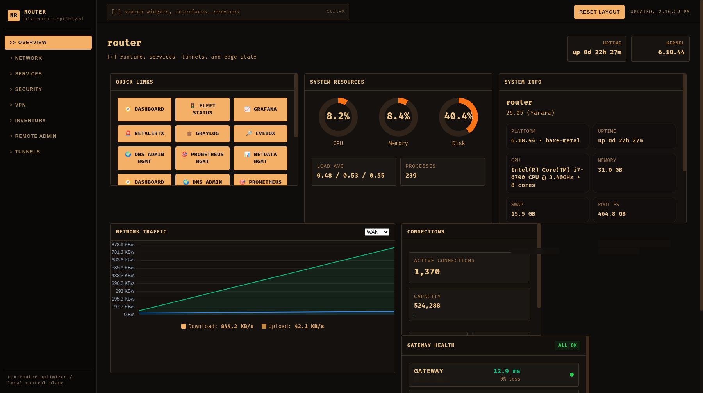

# nix-router-optimized

[](https://opensource.org/licenses/MIT)
[](https://nixos.org)
[](https://nix-router.deepwatercreature.com/)
[](https://nix-ci.com/gh:deepwatrcreatur:nix-router-optimized)
[](https://github.com/deepwatrcreatur/nix-router-optimized/releases)

`nix-router-optimized` is a modular NixOS framework for high-throughput edge routing, stateful packet filtering, and deterministic multi-node failover on commodity x86_64 and aarch64 hardware.

You describe the router once, as a typed topology: interfaces, subnets, roles and the HA pair. The modules derive nftables, DHCP (systemd-networkd or Kea), DNS, CAKE and keepalived from it. A conflicting address or a half-configured failover pair fails `nix build` instead of failing on the wire.

## Quickstart

Add the flake and import `nixosModules.default`. It imports every module, and each module stays off until you enable it.

```nix
# flake.nix
{
  inputs = {
    nixpkgs.url = "github:NixOS/nixpkgs/nixos-unstable";
    router-optimized = {
      url = "github:deepwatrcreatur/nix-router-optimized";
      inputs.nixpkgs.follows = "nixpkgs";
    };
  };

  outputs = { nixpkgs, router-optimized, ... }: {
    nixosConfigurations.router = nixpkgs.lib.nixosSystem {
      system = "x86_64-linux";
      modules = [
        router-optimized.nixosModules.default
        ./hardware-configuration.nix
        ./router.nix # start from examples/router-single-basic.nix
      ];
    };
  };
}
```

Starting points:

| Example | What it builds | Checked by |
| :--- | :--- | :--- |
| [`examples/router-single-basic.nix`](examples/router-single-basic.nix) | One router: DHCP WAN, routed LAN, DHCP, Unbound, firewall, CAKE | `docs-router-single-basic-example-eval`, `docs-readme-quickstart-default-module-eval`. The VM test `vm-smoke` boots a router of the same shape and routes a client through it. |
| [`examples/router-ha-pair-example.nix`](examples/router-ha-pair-example.nix) | A VRRP pair sharing the LAN gateway and the WAN, with the password read from a file | `docs-router-ha-pair-master-example-eval`, `docs-router-ha-pair-backup-example-eval`. The VM tests `vm-router-ha-pair`, `vm-router-ha-wan-failover` and `vm-router-ha-wan-health` run a pair through failover. |

Run any check with `nix build .#checks.x86_64-linux.<name>`. The flake has 14 VM tests (`vm-*`) and more than 350 evaluation checks. [`CHANGELOG.md`](CHANGELOG.md) lists the releases, and [`docs/STABILITY.md`](docs/STABILITY.md) says which option changes you can expect between them.

## Router dashboard

The dashboard gives operators a live view across eight pages. The capture
below shows the Overview page; the [full screenshot gallery](docs/screenshots/README.md)
contains one image for each page. Network addresses, MAC addresses, and
internal hostnames are blurred in the gallery.



The framework is aimed at operators who value the architectural rigor, formal state separation, and auditability associated with systems like OpenBSD (`pf`, `carp`, `relayd`), but require modern Linux dataplane capabilities: Netfilter FastTrack flowtables, eBPF/XDP hooks, multi-queue SMP IRQ distribution, CAKE Smart Queue Management (SQM), and bit-reproducible deployments managed entirely through GitOps.

---

## Architectural Principles

Traditional edge routing solutions suffer from two common failure modes:
1. **Imperative Web Appliances** (e.g. pfSense, OPNsense): Rely on mutable runtime state, PHP-driven web forms, and monolithic XML databases (`config.xml`). Subsystems drift across manual updates, rollbacks require full disk images or ZFS snapshots, and configurations cannot be statically checked before deployment.
2. **Ad-Hoc Linux Scripts**: Cobbled together with shell scripts, disjoint `systemd-networkd` files, and imperative `iptables`/`nftables` rulesets. These lack formal schemas, cannot detect subnet or port collisions at evaluation time, and introduce edge cases during daemon reloads.

`nix-router-optimized` structures the router as a **purely synthesized appliance**:

```
+-------------------------------------------------------------+
|                     Typed Topology Model                    |
|   Interfaces, Subnets, VLANs, Security Zones, Bandwidths    |
+-------------------------------------------------------------+
                              |
                              v  (Evaluation-time assertions)
+-------------------------------------------------------------+
|                   Derived System Services                   |
|  - nftables rulesets & FastTrack flowtables                 |
|  - ISC Kea DHCPv4 / DHCPv6-PD subnet reservations           |
|  - Technitium / Unbound DNS zones & upstream forwarders     |
|  - CAKE qdiscs & per-interface bandwidth limits             |
|  - NIC ring buffers, offload flags & SMP IRQ affinities    |
+-------------------------------------------------------------+
                              |
                              v  (deploy-rs / nixos-rebuild)
+-------------------------------------------------------------+
|              Immutable System Generation (NixOS)            |
|   Atomic activation, cryptographic store paths, rollbacks   |
+-------------------------------------------------------------+
```

1. **Topology as the Single Source of Truth**: Interfaces, subnets, VLAN tags, and routing zones are defined once in a typed configuration. The framework compiles this topology into consistent configurations across Netfilter, ISC Kea, Technitium DNS, and CAKE. Addressing conflicts and invalid routes fail the Nix build before any system state changes.
2. **Deterministic Fail-Safe Deployments**: Every system change yields an immutable NixOS generation. Deployments via `deploy-rs` execute automated canary checks with atomic rollback on connectivity loss. If a faulty kernel or configuration breaks routing, the previous known-good generation is selected at the bootloader.
3. **Resource Slice Isolation**: Packet forwarding is ring-fenced from telemetry and secondary services using a hierarchical systemd slice structure (`router-core.slice`, `router-observability.slice`, `router-applications.slice`). Memory limits, CPU shares, and I/O weights guarantee that heavy analytical queries or logging cannot starve the network forwarding plane.
4. **Hardware Dataplane Offloading**: Netfilter flowtables bypass connection tracking for established streams, reducing per-packet CPU overhead. Automatic NIC driver negotiation configures ring buffers, hardware offloads (TSO, GSO, GRO), and multi-queue SMP affinity to balance interrupt workloads across available CPU cores.

---

## High Availability & Failover Architecture

High availability is actively implemented and tested on a physical dual-node homelab pair:
* **Primary Node (`router`)**: QEMU/KVM virtual machine with dedicated Intel I225/I226 2.5GbE (`igc`) interfaces.
* **Standby Node (`elitedesk`)**: Bare-metal HP EliteDesk with dual-port Intel 82599/X520-DA2 10GbE SFP+ (`ixgbe`) interfaces.

### Topology Constraints & Failover Sequence
The pair shares an unmanaged L2 switch upstream connected to an ISP cable modem providing a single dynamic IPv4 lease locked to a single hardware MAC address:

```
                            [ ISP Modem ]
                                  |
                                  | (Single Dynamic DHCP Lease)
                                  v
                     [ Unmanaged L2 WAN Switch ]
                             /         \
                            /           \
                 (Active WAN)           (always-down)
                          v               v
                +----------------+ +----------------+
                |  router (VM)   | | elitedesk (BM) |
                |  MASTER        | | BACKUP         |
                |  VIP Owner     | | Standby        |
                +----------------+ +----------------+
                        |                 |
                        +--------+--------+
                                 | (VRRP Heartbeat + State Sync)
                                 v
                     [ Managed L2 LAN Switch ]
                                 |
                          (LAN Subnets)
```

1. **VRRP State Machine (RFC 5798)**: Keepalived manages floating Virtual IPs (VIPs) across internal LAN interfaces. Heartbeats traverse dedicated internal links. Authentication credentials are loaded dynamically at runtime via systemd credentials (`vrrpPasswordFile`), keeping secrets out of the world-readable `/nix/store`.
2. **Flap Prevention (`preemptDelay`)**: The primary node is configured with a 300-second preemption delay. When recovering from a reboot or failure, it remains in `BACKUP` state until the system is fully stabilized, preventing split-brain flap cycles.
3. **ISP Golden MAC Handover**: The active node clones the ISP-expected MAC address onto its WAN interface. The standby node enforces `ActivationPolicy = "always-down"` on its physical WAN link. During failover, the standby activates the link, assumes the Golden MAC, and issues a DHCP discover.
4. **Stateful DNS Replication**: Technitium zones (including RFC 2136 dynamic DDNS updates) are continuously replicated from Primary to Standby over TSIG-authenticated AXFR/IXFR. Under `services.router-technitium.zoneReplication.ha`, the standby promotes replicated zones to Primary upon assuming `MASTER` status.
5. **Session Synchronization (`conntrackd`)**: TCP and UDP connection tracking tables are synchronized between nodes in FTFW (fault-tolerant flow-writer) mode, enabling active sessions to survive failover without dropping state.

### Operational Boundaries
* **DHCP Leases**: Kea DHCPv4 operates in a **single-active with manual promotion** posture ([`docs/router-dhcp-single-active.md`](docs/router-dhcp-single-active.md)) to avoid split-brain lease allocation across unsynchronized pools.
* **Reconfiguration Mechanics**: Interface promotion transitions from full `systemd-networkd` daemon restarts to scoped `networkctl reconfigure` operations to eliminate transient carrier drops on unaffected interfaces.

---

## Technical Comparison: Linux/NixOS vs. OpenBSD / FreeBSD

Operators evaluating dedicated router platforms frequently weigh Linux-based declarative systems against BSD-based appliances (OPNsense, pfSense, or vanilla OpenBSD):

| Subsystem / Capability | `nix-router-optimized` (Linux / NixOS) | BSD Appliances (OPNsense / pfSense) | Vanilla OpenBSD |
| :--- | :--- | :--- | :--- |
| **Configuration Model** | Pure Nix expressions; type-checked, version-controlled, bit-reproducible. | Imperative web UI; mutable runtime `config.xml` database on disk. | Plain text configuration files (`pf.conf`, `hostname.if*`); manual sync. |
| **Deployment & Rollback** | Atomic NixOS generations; instantaneous bootloader rollback. | In-place updates; requires ZFS boot environments or full backups. | Manual backup of configuration files and system kernels. |
| **Packet Filtering Engine** | Netfilter (`nftables`) with hierarchical chains and flowtables. | FreeBSD `pf` (derived from OpenBSD pf, modified for SMP). | OpenBSD `pf` (clean syntax, single-threaded state engine). |
| **Kernel Dataplane Bypass** | FastTrack flowtables (line-rate L4 bypass); eBPF/XDP ring-buffer filtering. | No native XDP equivalent; packet processing remains in kernel stack. | No XDP or flowtable equivalent; strict kernel packet path. |
| **High Availability Protocol** | Keepalived (VRRP v2/v3, RFC 5798) with dynamic promotion scripts. | CARP (Common Address Redundancy Protocol, IP protocol 112). | Native CARP + `ifstated`. |
| **State Synchronization** | `conntrackd` in FTFW mode (multicast or unicast UDP/TCP). | `pfsync` (kernel-level packet filter state sync). | Native `pfsync`. |
| **Hardware SMP Scaling** | Explicit per-CPU IRQ affinity, RPS, XPS, and multi-queue MSI-X distribution. | Multi-threaded kernel stack, driver-dependent interrupt allocation. | Single-lock / coarse-grained networking stack throughput limits. |
| **Traffic Conditioning** | CAKE and fq_codel SQM; per-host and per-flow bandwidth isolation. | dummynet / ipfw pipes, fq_codel, or ALTQ. | HFSC and CBQ via `pf.conf`. |

For a comprehensive architectural breakdown, read **[`docs/FREEBSD-OPNSENSE-COMPARISON.md`](docs/FREEBSD-OPNSENSE-COMPARISON.md)**.

---

## Minimal Gateway Specification

The following flake module defines a production edge gateway with WAN DHCP, a routed LAN subnet, FastTrack flowtable acceleration, CAKE queue management, and an Unbound recursive resolver:

```nix
{ inputs, ... }: {
  imports = [
    inputs.router-optimized.nixosModules.router-networking
    inputs.router-optimized.nixosModules.router-dhcp
    inputs.router-optimized.nixosModules.router-dns-service
    inputs.router-optimized.nixosModules.router-firewall
    inputs.router-optimized.nixosModules.router-optimizations
  ];

  # 1. Interface and Prefix Topology
  services.router-networking = {
    enable = true;
    wan.device = "eth0";
    routedInterfaces.lan = {
      device = "eth1";
      ipv4Address = "192.168.1.1/24";
      dns = [ "192.168.1.1" ];
      ipv6SendRA = true;
    };
  };

  # 2. Dynamic Addressing & Name Resolution
  services.router-dhcp.enable = true;
  services.router-dns-service = {
    enable = true;
    provider = "unbound";
  };

  # 3. Netfilter Policy & Hardware Optimizations
  services.router-firewall.enable = true;
  services.router-optimizations = {
    enable = true;
    interfaces = {
      wan = { device = "eth0"; role = "wan"; label = "WAN"; bandwidth = "1Gbit"; };
      lan = { device = "eth1"; role = "lan"; label = "LAN"; };
    };
  };
}
```

---

## Documentation Index

In-depth implementation notes, configuration schemas, and design records are organized by domain:

| Document | Scope & Focus |
| :--- | :--- |
| **[Documentation Portal](https://nix-router.deepwatercreature.com/)** | Architecture portal with SVG topology blueprints, failover flows, and interactive module references. |
| **[`docs/MODULES.md`](docs/MODULES.md)** | Complete reference guide for all 38+ framework modules, option definitions, and default values. |
| **[`docs/RECIPES.md`](docs/RECIPES.md)** | Tested deployment recipes: PPPoE, Caddy reverse proxy, Technitium blocklists, and WARP routing. |
| **[`docs/PERFORMANCE-TUNING.md`](docs/PERFORMANCE-TUNING.md)** | In-depth analysis of Netfilter flowtables, NIC driver offloads, CAKE tuning, and SMP affinity. |
| **[`docs/FREEBSD-OPNSENSE-COMPARISON.md`](docs/FREEBSD-OPNSENSE-COMPARISON.md)** | Technical comparison of Linux/NixOS vs. FreeBSD/OPNsense (CARP vs VRRP, pfsync vs conntrackd). |
| **[`docs/VYOS-FEATURE-PARITY-PLAN.md`](docs/VYOS-FEATURE-PARITY-PLAN.md)** | Comparison with VyOS and the gap list, with what is shipped and VM-tested versus missing. |
| **[`docs/ECOSYSTEM-RESEARCH-AND-IMPROVEMENT-PLAN.md`](docs/ECOSYSTEM-RESEARCH-AND-IMPROVEMENT-PLAN.md)** | Architectural survey, homelab consumer invariants, secrets management bootstrap paradox, and roadmap. |
| **[`docs/COMPATIBILITY.md`](docs/COMPATIBILITY.md)** | Driver and hardware compatibility matrix (Intel 2.5G/10G, Broadcom, Rockchip, Realtek). |
| **[`docs/work-items/README.md`](docs/work-items/README.md)** | Ranked technical work backlog, design decisions, and agent implementation runbooks. |

---

## Hardware Compatibility

The framework is verified on x86_64 and aarch64 architectures across three primary hardware tiers:
* **Tier 1 (Core)**: Intel I225/I226 (2.5G `igc`), Intel X520/X540/X550 (10G `ixgbe`), Intel I350 (1G `igb`). Full multi-queue MSI-X, hardware timestamping, and flowtable bypass supported.
* **Tier 2 (SBC)**: Rockchip RK3568 / RK3588 (NanoPi R4S / R5S) and Broadcom BCM2711 / BCM2712 (Raspberry Pi 4 / 5).
* **Tier 3 (Commodity)**: Realtek RTL8125 / RTL8111 (`r8169`) and Mellanox ConnectX-3 / ConnectX-4 (`mlx4` / `mlx5`).

See [`docs/COMPATIBILITY.md`](docs/COMPATIBILITY.md) for detailed driver flags and ring buffer tuning notes.

---

## License

This project is licensed under the [MIT License](LICENSE).
