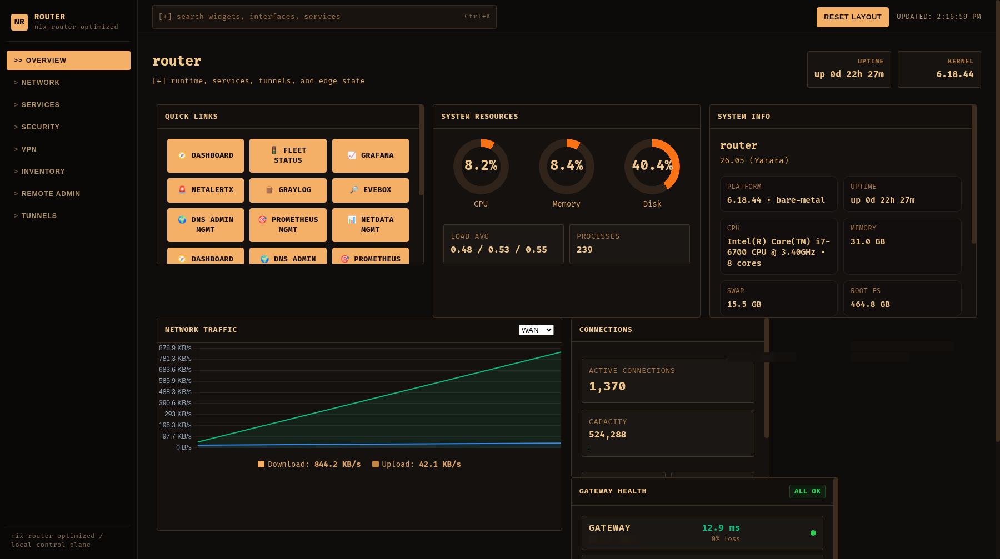
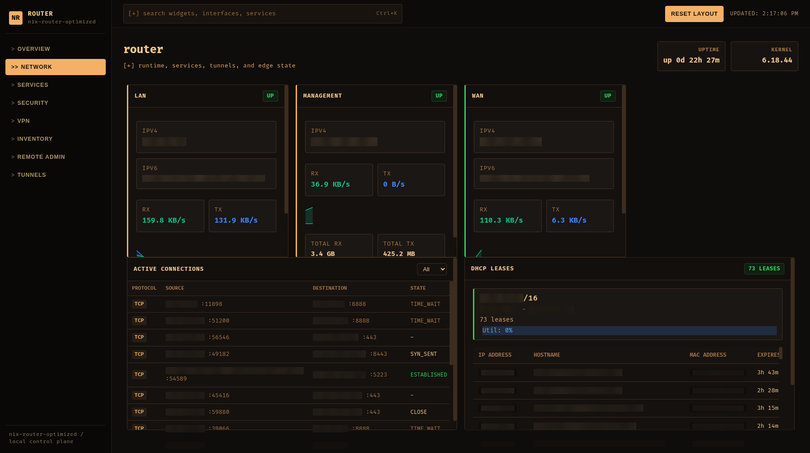
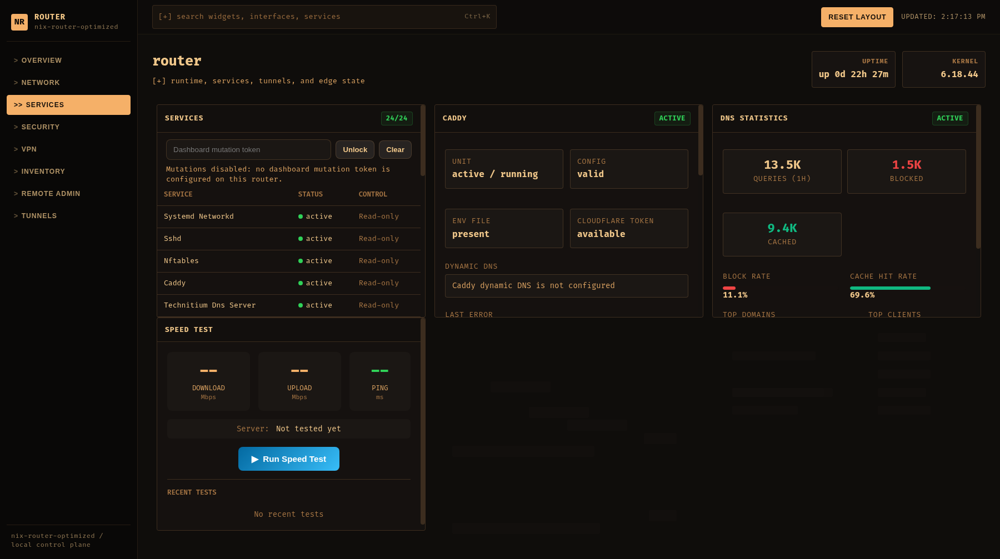
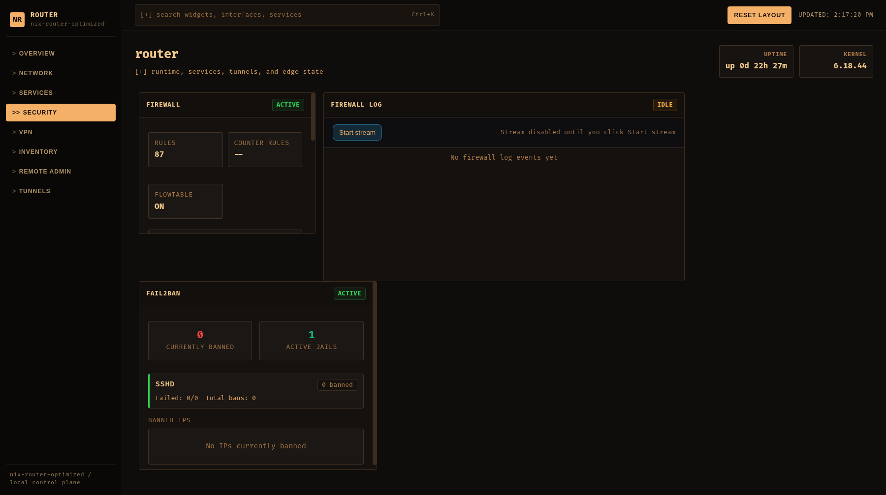
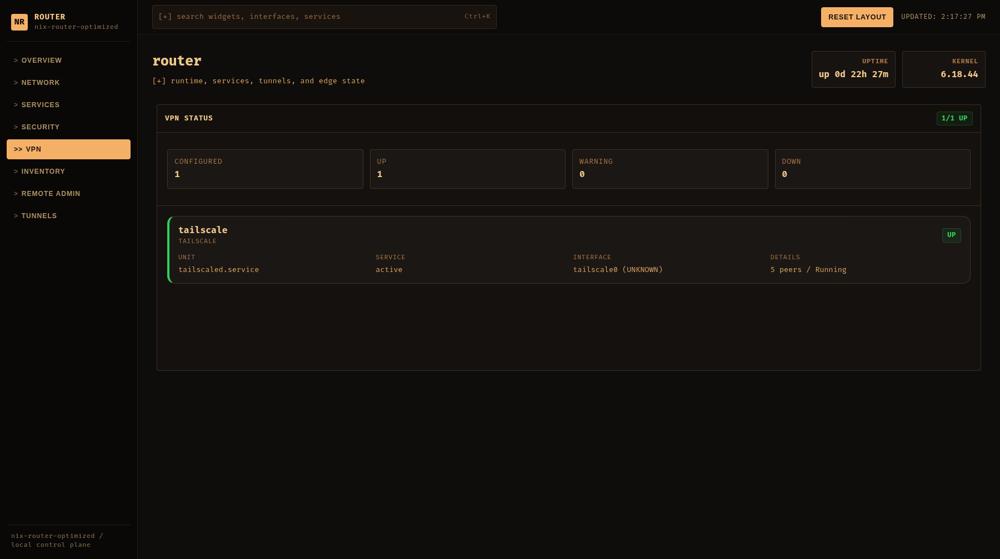
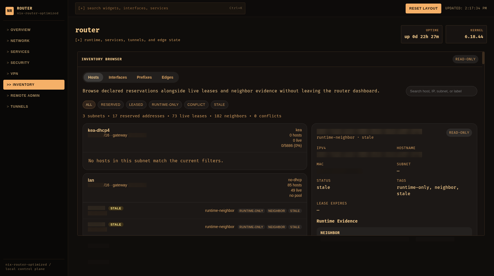
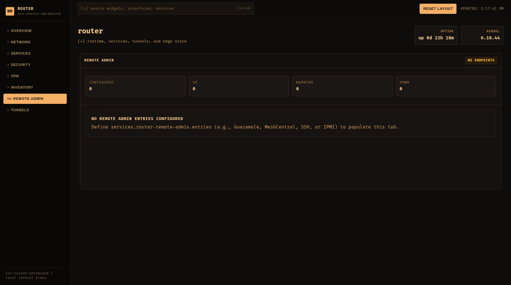
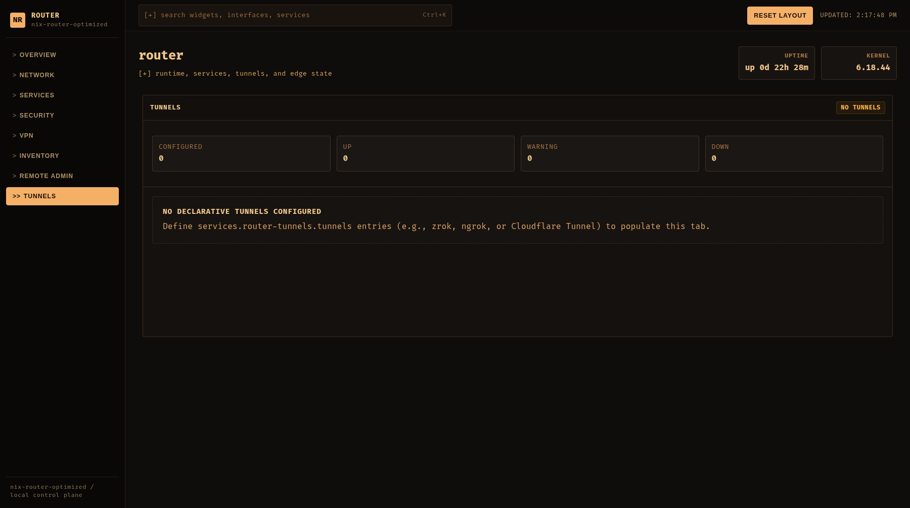

# Router dashboard screenshots

These captures show the live router dashboard. Network addresses, MAC
addresses, and internal hostnames are blurred before capture; the dashboard
itself is unchanged.

| Overview | Network |
| --- | --- |
|  |  |

| Services | Security |
| --- | --- |
|  |  |

| VPN | Inventory |
| --- | --- |
|  |  |

| Remote Admin | Tunnels |
| --- | --- |
|  |  |
